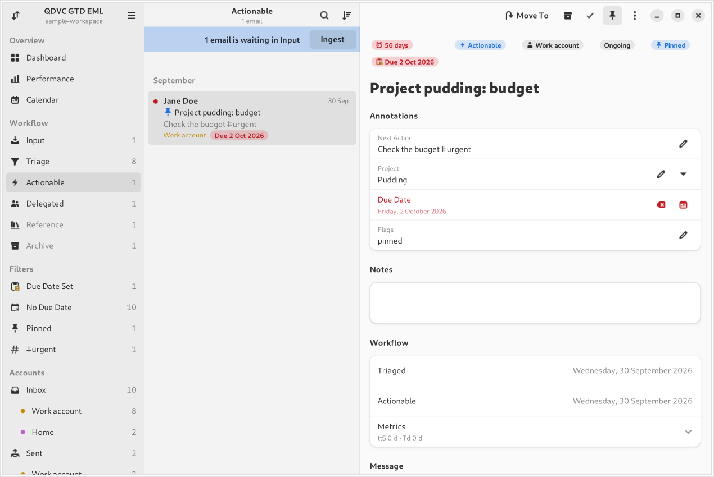

# QDVC GTD EML

Work a [Getting Things Done](https://gettingthingsdone.com/) workflow over plain
`.eml` email files. Export the emails you need to act on into a folder, and
QDVC GTD EML files them, tracks what you decided about each one, and shows how
your backlog is doing. Part of the [QDVC suite](https://github.com/qdvc-apps).

This monorepo holds three editions that work on the same workspaces:

| Folder | Edition | Platform | Read more |
| --- | --- | --- | --- |
| [`commandline/`](commandline/) | the `gtd` command-line tool, plus a generated static report website | Python 3, any OS | [README](commandline/README.md), [MAINTENANCE](commandline/MAINTENANCE.md) |
| [`gtk4/`](gtk4/) | QDVC GTD EML for GNOME | Python, GTK 4 and libadwaita (GNOME 46+) | [README](gtk4/README.md), [docs/](gtk4/docs/) |
| [`mac/`](mac/) | QDVC GTD EML for macOS | Swift, SwiftUI and AppKit (macOS 14+) | [README](mac/README.md), [docs/](mac/docs/) |



## The workspace is the contract

A workspace is a folder with six workflow folders and two files:

```
01-input/  02-triage/  03-actionable/  04-delegated/  05-reference/  06-archive/
metadata.csv     one row per email: next action, project, due date, flags, notes, ds_* date stamps
workspace.yml    optional settings shared by every edition (accounts, monitored hashtags, …)
```

Every edition reads and writes these files the same way, byte for byte, so you
can use the CLI, the GNOME app and the Mac app on one workspace, in turn or
side by side. Any change that would make one edition name a file or write a
byte of `metadata.csv` differently from the CLI is a bug. The format is
described in [`gtk4/docs/FILE_FORMAT.md`](gtk4/docs/FILE_FORMAT.md) (the Mac
edition has the same document).

[`sample-workspace/`](sample-workspace/) is a small workspace made by the CLI,
used by the tests of both apps and handy for trying them out. Work on a copy:
the apps write to the workspace they open.

## Getting started

```
# Command line (needs PyYAML)
cd commandline && python3 gtd.py help

# GNOME (Debian/Ubuntu shown; see gtk4/README.md for Fedora)
sudo apt install python3-gi python3-gi-cairo gir1.2-gtk-4.0 gir1.2-adw-1 python3-yaml
gtk4/scripts/build-app.sh --install

# macOS (needs full Xcode, not just the Command Line Tools)
mac/scripts/build-app.sh --install
```

## How the editions share their logic

The CLI is the reference implementation; the apps follow it.

- **The GNOME edition runs the CLI's own code.** `gtk4/qdvc/gtd_modules/` is an
  unmodified copy of `commandline/gtd_modules/`, refreshed with
  `gtk4/tools/vendor_core.py`. Its tests fail if the copy was edited by hand
  or has fallen behind `commandline/`. (It keeps a copy so that the installed
  app is self-contained.)
- **The Mac edition is a Swift port** (`mac/Sources/GTDCore`), pinned to the
  CLI by a parity fixture: `mac/tools/make_fixtures.py` runs the CLI's code over
  awkward test emails and scripted sessions and records the results in
  `mac/Tests/GTDCoreTests/Fixtures/parity.json`. The GNOME edition replays the
  same fixture (`gtk4/tests/fixtures/parity.json`, which its tests check is
  identical).

After changing the CLI, refresh both:

```
cd gtk4 && python3 tools/vendor_core.py && scripts/build-app.sh
cd mac && python3 tools/make_fixtures.py && cp Tests/GTDCoreTests/Fixtures/parity.json ../gtk4/tests/fixtures/
```

## Feature parity between the two apps

The GNOME and Mac apps have the same features: Workflow folders, filters
(Smart Mailboxes on the Mac) and per-account Inbox and Sent; Dashboard,
Performance and Calendar; ingest, move, archive, Close With, pin and in-place
annotations, each with the CLI's refusals; Review Date Stamps and Check
Metadata; "Closed with" history chains; dropping on a hashtag (or Set Next
Action) to fill a blank next action; opening emails in tabs, including dragged
out into their own window; and live reload when the workspace changes on disk.
A feature added to one is added to the other, adapted to the platform.

Where they differ, it is because the platforms do:

- The Mac follows Apple Mail (menu bar, toolbar, native window tabs, Quick
  Look, collapsible date headings, Liquid Glass); the GNOME app follows Geary
  and the GNOME HIG (split header bars, `Adw.TabView` tabs, toasts and
  banners, annotations applied field by field, an adaptive layout down to
  phone width).
- Shortcuts follow each platform: ⌘W / ⌘⇧T / ⌘1–9 for tabs on the Mac,
  Ctrl+W / Ctrl+Shift+T / Alt+1–9 on GNOME.

The command-line edition has fewer interactive features by design, and has
things the apps don't (the static report website, exports).

## Tests

```
cd gtk4 && scripts/build-app.sh        # unit, parity and headless UI tests (Xvfb)
cd mac && swift test                   # GTDCore unit and parity tests (with DEVELOPER_DIR set to Xcode)
```

The GNOME edition's UI test drives the real window headless and checks the
workspace afterwards; the Mac app's SwiftUI code is only exercised by building
and running it on a Mac.

## History of this repository

The three editions began as separate repositories and were merged here in
November 2026, each into its own folder. `qdvc-gtd-eml-mac` and
`qdvc-gtd-eml-gtk4` keep their original histories. The CLI's history was
rewritten by the merge, so links pinned to its old commits (for example
`6d1830abdb77…`) no longer resolve here.

## AI assistance

These editions were written with an AI assistant. The conversation logs, kept
according to the
[Vibecoding Recordkeeping Specification](https://github.com/blairwang-online/vibecoding-recordkeeping-specification),
are in [`ai-assistance-logs/`](ai-assistance-logs/), suffixed by edition
(`-COMMANDLINE`, `-GTK4`, `-MAC`; logs written after the merge have no
suffix). Platform gotchas found along the way are written up for the
[QDVC Cursed Knowledge](https://github.com/qdvc-apps/qdvc-cursed-knowledge)
collection; reports from this repository go in `cursed-knowledge-reports/`.

## License

No license has been chosen yet. Add a `LICENSE` file before publishing.
